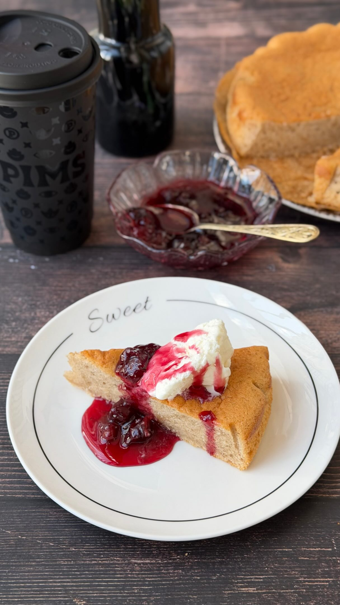

# Бретонский пирог на пиве

Бретонский пирог с ароматом солода, дрожжей и ноткой вишнёвой косточки. Возможны вариации с другим вкусным пивом, например темное пиво + карамельное мороженое.

#### Ингредиенты

* яйца 3 шт.
* сахар 100 г
* растительное масло без запаха 100 г
* вишнёвое пиво 200 г
* пшеничная мука 200 г
* разрыхлитель 6 г

#### Приготовление

Белки отделить от желтков. Желтки взбить с сахаром добела. Добавить растительное масло и пиво, перемешать. Всыпать муку с разрыхлителем, перемешать до однородности. Белки взбить и аккуратно вмешать в первую смесь в 3 приёма.

Форму смазать маслом или застелить бумагой для выпечки. Переложить тесто в форму.

Выпекать при 150 °C около 45 минут до сухой лучины.

Охладить до комнатной температуры перед подачей. Подавать с вишнёвым вареньем и ванильным мороженым.

_ig: foodedlife_
